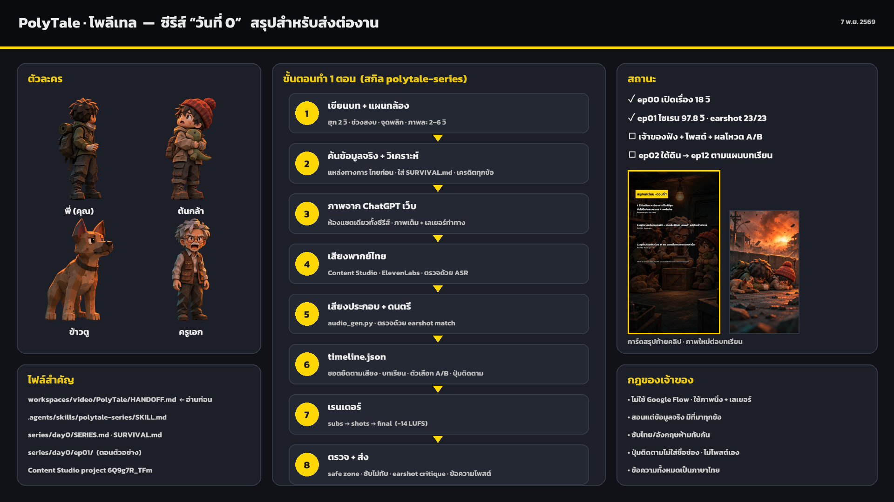

# PolyTale — handoff for the next AI (long-running series)

Written 2026-11-07 (พ.ศ. 2569) at the end of the session that built the channel, the skill and
episodes 00–01 of "วันที่ 0". Read this file top to bottom before doing anything, then follow the
skill. Everything you need is in the repository; nothing depends on this conversation.

## 1. Read these, in this order

1. `.agents/skills/polytale-series/SKILL.md` — the production method (rules, story craft,
   lessons, shot types, voice, sound, render, QC, delivery). **Follow it step by step.**
2. `workspaces/video/PolyTale/CHANNEL.md` — channel bible (format, look, captions, hashtags).
3. `workspaces/video/PolyTale/series/day0/SERIES.md` — story bible, characters, layers, voices,
   devices, episode table and statuses.
4. `workspaces/video/PolyTale/series/day0/SURVIVAL.md` — the **only** facts a lesson may teach,
   with credits, plus the lesson map for episodes 1–12. Evidence:
   `series/day0/research/survival-sources-2026-11-07.md`.
5. `.agents/skills/polytale-series/references/timeline.md` — every timeline.json field.
6. The reference episode `series/day0/ep01/` — `SHOTS.md`, `timeline.json`, `build_timeline.py`
   (the generator that wrote it), `review/check/critique-final.txt`.
Also: `AGENTS.md` (repo map), `.agents/skills/chatgpt-images/SKILL.md` (images in ChatGPT web),
`.agents/skills/thai-voiceover/SKILL.md`, `.agents/skills/earshot/SKILL.md`.

## 2. What exists now

| Item | State | Where |
| --- | --- | --- |
| Channel | named PolyTale · โพลีเทล; handle `@polytale.th` proposed, **not registered** (owner does it) | CHANNEL.md |
| Series | "วันที่ 0", 12 episodes planned + ep00 opening test | SERIES.md |
| ep00 | 18 s opening test (old absolute timeline style) | `series/day0/ep00/` |
| ep01 | **final v5: 97.8 s**, −14.4 LUFS, earshot critique 23/23 "launch-grade"; summary card image | `series/day0/ep01/render/day0-ep01.mp4`, `day0-ep01-summary.png` |
| Earlier ep01 versions | v1–v4 kept for comparison | `series/day0/ep01/review/day0-ep01-v*.mp4` |
| Content Studio | main project `6Q9g7R_TFm` "PolyTale · วันที่ 0", workspace `workspaces/video/PolyTale`; ep00 `6_FyU76Uha`, ep01 `F2382pG3tg` | MCP `content-studio` |
| ChatGPT | one conversation for every image of the series (account kinjis_1 in Claude in Chrome) | URL in SERIES.md |
| Not yet | owner has not listened to ep01; nothing posted; ep01 viewer vote result unknown; work since commit `684eece` is **not committed** | — |

## 3. Owner decisions you must keep (from the conversation)

- All user-facing text in **Thai** (chat, captions, on-screen), English only as the small second subtitle.
- **Master Thai Craft (กฎเหล็ก):** Scripts and narration must strictly follow `.agents/skills/thai-craft/SKILL.md`
  (dynamic flow, no word-locking, zero English calques, proper Thai dialogue registers with ครับ/ค่ะ/ลูก,
  verb-serial storytelling, 3-second spoken test). Mandatory Human Gate: present Thai draft for owner
  approval before voice generation.
- **No Google Flow / Veo / paid video.** Motion = stills + transparent layers composited by the scripts.
- Layers are preferred (characters, scene, atmosphere, animals, props as separate pieces).
- GPT GIFs, when used, come from the normal ChatGPT web chat (not only the API).
- Every episode **teaches real, practical survival/life skills** — only facts researched at
  official sources and analysed (Thai sources first: ปส./OAP, ปภ.; then WHO, CDC, Ready.gov),
  **credited per step**, narration faithful to the source. Show the scope line and Thai hotlines
  (ปส. 1296, ปภ. 1784).
- Subtitles must never overlap (Thai above English, measured); check `review/subs-sheet.png`.
- End of every episode: lesson (new picture per step) → A/B viewer choice → title → **summary
  card** + **animated follow button without the channel name**.
- Professional bar: run the full `earshot critique` and fix all critical/major rows; look at a
  frame every 3 s; no picture held more than ~8 s.
- Save files without asking but always inside the BigO folder. Never post anything; give the owner
  a posting line (caption + hashtags) and let them post.
- Report honestly: what you looked at, ASR results, measured numbers, and what nobody has heard yet.

## 4. Next steps (in order)

1. **Wait for the owner**: listen to ep01 (`render/day0-ep01.mp4`); post it themselves; tell you the
   A/B vote result. Record the result in SERIES.md (ep01 row) — it decides ep02's location
   (A = basement under ครูเอก's radio shop, B = subway station).
2. **Ep02 "ใต้ดิน"** (วันที่ 0, the first hours in shelter). Lesson facts from SURVIVAL.md: F7 (close
   up, fans/AC off), F5 (24 h, leave only for immediate hazard or official word), F8 (radio,
   official channels). Everyday use: haze/PM2.5 days. Start with a 2–3 s recap of ep01 and the
   vote result. Keep the devices: day stamp, timer → a radiation counter from now on, the dinosaur.
3. Images first (a Sonnet subagent in Claude in Chrome, series conversation): full frames for each
   shot, a basement plate, acting layers for the brothers and ครูเอก (blink, look, reactions). Check
   identity against `characters/` and record in `assets/ASSETS.md`.
4. Voice (Content Studio `create_content` → `voice_content` → `scripts/voice.py` ASR check; single
   re-takes via `lines` with ElevenLabs voice `XELzaccf66eUgLtL3BV1`; child ต้นกล้า
   `w3e1Jn4F37O7wDwETrJ9` pitch 1.18). Words that came out wrong before: "ห่าง" (use "ไกล"),
   whispered short lines (use `[ตึงเครียด]`), the v3 model sometimes **adds words** — always compare
   the transcript with the script.
5. Sound with `scripts/audio_gen.py` (ElevenLabs SFX/music, cached) and check key sounds with
   `earshot match` (need z ≥ 3; rewrite the prompt literally and raise `influence` if not).
6. Write `epNN/timeline.json` (copy ep01's structure / `build_timeline.py`), run the pipeline in
   SKILL.md §6, QC, critique, fix, then deliver with the posting line and update SERIES.md.
7. Continue ep03–ep12 the same way, following the lesson map. Before teaching a new fact, research it
   (SKILL.md §1b) and add it to SURVIVAL.md with its sources.

## 5. Commands (from the episode folder)

```bash
S=B:/ChatGPT/BigO/.agents/skills/polytale-series/scripts
python $S/tl.py .            # resolved shot times
python $S/audio_gen.py .     # ElevenLabs sfx / music / extra lines (cached)
python -X utf8 $S/subs.py .  # overlay: subtitles, cards, lessons, choice, title, follow
python $S/shots.py .         # picture (~9 s of CPU per second of video; run in background)
python -X utf8 $S/final.py . # mix + loudness; prints duration / LUFS / true peak
python -X utf8 $S/qc.py .    # review/strip.png (safe zones), review/subs-sheet.png, sub crops
powershell -NoProfile -ExecutionPolicy Bypass -File B:/ChatGPT/BigO/content-studio/local-earshot/earshot.ps1 critique render/<id>.mp4
```
To re-render one shot only: `ONLY=s21 python $S/shots.py . review/test/s21.mp4`, then concat it after
the unchanged head of `render/shots.mp4` (as done in this session) and re-run `final.py`.

## 6. Known pitfalls (learned the hard way)

- `final.py` once cut all audio after the last voice line (sidechain ended early) — fixed with
  `apad`; if the end goes silent again, check the filter graph first.
- Thai subtitles overlapped English when English wrapped — fixed in `subs.py` by measuring with the
  real font; never place subtitles by hand.
- Quoted heredocs with apostrophes (e.g. "won't") break the Bash tool; write such scripts with the
  Write tool instead. In Python f-strings, ASS tags need raw strings (`\f`, `\a`, `\t` are escapes).
- ChatGPT redraws characters for every layer; build each shot from layers made for it.
- ElevenLabs SFX prompts: plain physical descriptions; phone alerts and whooshes needed literal
  re-prompts. Music needs gain ~0.45 to count as present under the voice.
- The ending gets quiet when cards are added — keep the end sting on the very last shot.
- **Voiceover-First Sound Mix (Owner Rule, 8 Nov 2026)**: เสียงพากย์ต้องเป็นพระเอกนำหน้าเสมอ:
  - `vo_gain: 1.45` บังคับตั้งค่านี้ใน timeline.json เสมอเพื่อให้เสียงพูดชัดเจนไม่อู้อี้
  - `duck: {ratio: 4.5, threshold: 0.08}` ดึงดนตรีลงลึก -10dB ถึง -12dB ทันทีที่มีบทพูด
  - `music`: gain 0.18–0.22 (ห้ามเกิน 0.25)
  - เสียงรถ (`traffic`) และเสียงคนกรีดร้อง/ฝูงชน (`crowd`): gain 0.08–0.10 เท่านั้น เป็นเพียงแอมเบียนต์ไกล ๆ ห้ามแหลมแทงหูหรือกลบเสียงพากย์
  - `cut_sfx` (whoosh): gain <= 0.08, Foley ในห้อง 0.10–0.15, เสียงกระแทก/ตูม 0.25–0.30, End Sting 0.40
- **Outro & Choice Hold Times (Owner Rule, 8 Nov 2026)**:
  - การ์ดทางเลือก A/B (`choice`): ต้องค้างภาพหลังเสียงพากย์จบอย่างน้อย 5–6 วินาที (รวมช็อต 13–15s) เพื่อให้คนดูอ่านตัวเลือกและคิดคอมเมนต์ทัน
  - ช็อตปิดท้าย/ปุ่มติดตาม (`follow`): ต้องยาวอย่างน้อย 7–8.5s ให้คนดูมีเวลากดติดตามและกดออกทัน ไม่ตัดจบกะทันหัน
- **Visual Stacking & No-Collision (Owner Rule, 8 Nov 2026)**:
  - ห้ามใส่ซับไตเติลล่างจอซ้อนกับการ์ดบทเรียนเต็มจอ (`lessons`) หรือการ์ดทางเลือก (`choice`)
  - ห้ามใส่ปุ่มติดตาม (`follow`) ซ้อนในช็อตเดียวกับ `choice` หรือซับไตเติล ให้แยกเป็นช็อต Outro ปิดท้ายเสมอ

## 7. Summary image

The one-page picture of the whole project is `workspaces/video/PolyTale/handoff-summary.png`.


